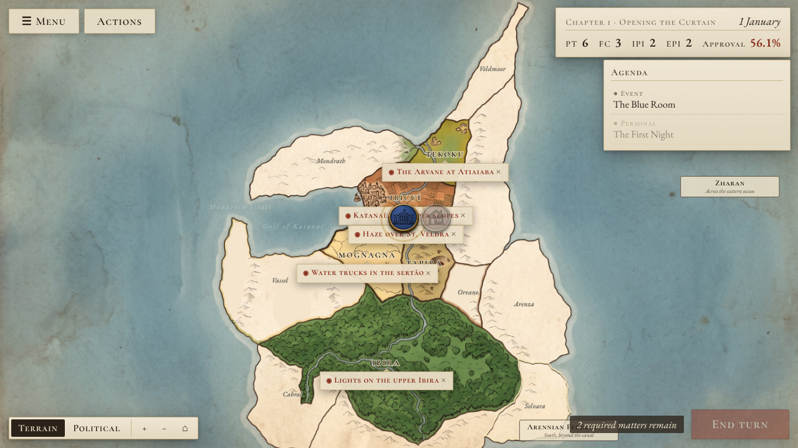

# Project Magnanimous

A Suzerain-style political narrative game set in the Republic of Kunasai. TypeScript + Vite, no UI framework,
deployed to GitHub Pages (later wrapped for Steam).



## Run

```bash
npm install
npm run dev        # http://localhost:5173
npm test           # vitest (engine, parser, runner, content corpus)
npm run build      # tsc --noEmit && vite build -> dist/
npm run preview    # serve dist/
```

Dev-only URL switches (stripped from production builds):
- `?corpus=main` plays the content snapshot in `tests/fixtures/main` instead of `content/`;
- `?corpus=demo` plays only `content/_demo` (exercises budget, vote, readables and tutorial highlights);
- `?showLocked` (or localStorage `magnanimous.dev.showLocked = 1`) shows `[lock if]` options greyed instead of hiding them.

## Structure

```
content/                 story data (scenes, characters, world, chapters, news, pop-ups, free actions, crises)
content/_demo/           placeholder content, used per category only when the real file is missing
docs/                    design (GDD mirror, DECISIONS, SCENE-FORMAT, story schemas), screenshots
public/map/              regions.json (geometry + borders), terrain.jpg / terrain-small.jpg, tokens/*.png
public/portraits/        optional <character portrait id>.png (silhouettes with initials are used otherwise)
src/core/                pure model: state, expressions, effects, turn update (rest values, drift), resources, crises
  tuning.ts              every balancing constant
src/scene/               scene parser (SCENE-FORMAT + Notion pages) and the scene runner state machine
src/content/             content discovery (import.meta.glob), lenient schema normalisation, cross-reference validation
src/game/                turn flow (availability, forced order, closing scene, newspapers, pop-ups, free actions), save/load
src/ui/                  DOM UI: title, map (terrain/political, markers, pins, pan/zoom), VN mode, HUD, newspaper
tests/                   vitest suites + fixtures (Inauguration Notion page, repo-format sample, content snapshot from main)
```

## How content is loaded

`src/content/loader.ts` bundles every `content/**/*.md` and `content/**/*.json` at build time. For each category
(scenes, world, characters, chapters, news, pop-ups, free actions, crises) the real files win; `content/_demo/` is used only
when a category is missing. Story-bound demo files (chapters, news, pop-ups, crises) are dropped as soon as any real
scene exists. JSON is normalised leniently (`src/content/schema.ts`): arrays or id-keyed objects, field aliases
(`opinion`/`loyalty`, `culture`/`culturalPower`, `gdp`, `acronym`…), missing regions/countries filled from GDD defaults.

In dev builds the console lists parse warnings and unresolved references (unknown regions, characters, news ids…).
`npm test` runs the same checks against `tests/fixtures/main`.

## Adding content

- **Scenes**: `content/scenes/**/*.md`, format in `docs/SCENE-FORMAT.md` and conventions in `docs/story/DATA-SCHEMAS.md`.
  Pages pasted from Notion (HTML tags, `- ↳` sub-bullets, "## Title — Subtitle" headings, `→ ECON topic` targets) parse too.
  Optional front-matter `token:` picks the map token (otherwise chosen from kind/title/location).
- **Turns**: `content/chapters.json` (`date`, `scenes`, `closing`, `popups`, `news`).
- **Crises**: `content/crises.json` (or `world.json → crises`):
  `{ id, scene, threshold, when, terms: [{expr, weight}], accumulate?, decay?, signalAt?, signals: {popups, news} }`.
  The hidden meter is Σ weight·expr each turn; at the threshold flag `crisis_<id>` is set and the scene becomes available.
- **Readables**: `content/readables.json` (and `content/popups.json`, same shape): pins on the map for their chapter/turn,
  click → paper card; optional `flags` set when read. Kinds `reaction | note | report | incident` get distinct icons.
- **Budget**: `content/ministries.json`; a scene token `[open: budget]` opens the screen. Flags `budget.<ministry>`,
  `initiative.<id>`; FC per turn and recurring effects apply at each turn update, `once` tokens when first funded.
- **Votes**: `content/bills.json`; `[vote: <bill-id>]` opens the vote screen (stances in words, whip deals; OPP small /
  medium / high prices, corrupt deals increment `corruption`, `voice`, `path_corrupt`). Flags `vote.<id>` and
  `vote.<id>.margin`. Yes = for + leaning + half of undecided; ≥ 51 passes, ≥ 44 passes watered down.
- **Tutorial**: `[highlight: hud-pt]` (inline or on its own line before a block). Choice costs are hidden until
  `flag.tutorial_done` (only when some scene sets it), then shown as a ◈ with a tooltip.
- **Scene flow**: every scene returns to the map. `order` only hides other markers until the forced scenes are done;
  `→ scene:<id>` unlocks that scene as a marker instead of playing it immediately.
- **Free actions**: `content/free-actions.json`:
  `{ id, label, description, cost: "1 PT", targets: "regions"|"countries"|[ids], effects: ["[approval +3 @ target]"], cooldown, result, scene? }`.

### Engine extensions to the token/expression language

- `[approval_rv +2 @ x]` (any index/stat with `_rv`) changes the rest value permanently instead of a decaying shock.
- `[tax domestic +5%]`, `[embargo: zharan]`, `[seats pm +1]`.
- Expressions also accept `+ - * /`, `done.<scene-id>`, `seen.<beat>.<n>`, `relation.<country>`, `crisis.<id>`,
  `national.<index>`, `<region>.<index>`, and bare identifiers as flags.
- On completion the engine sets `seen_<scene_id_with_underscores>`.

## Mechanics notes

Rest values and drift follow `docs/gdd/05-mechanics-reference`. Base terms are calibrated at game start so the opening
state is at rest; scene tokens are shock deltas that drift back unless they change the rest value. FC is calibrated
units-agnostically (state cost and FC bracket derived from the initial revenue). See `src/core/tuning.ts`.
